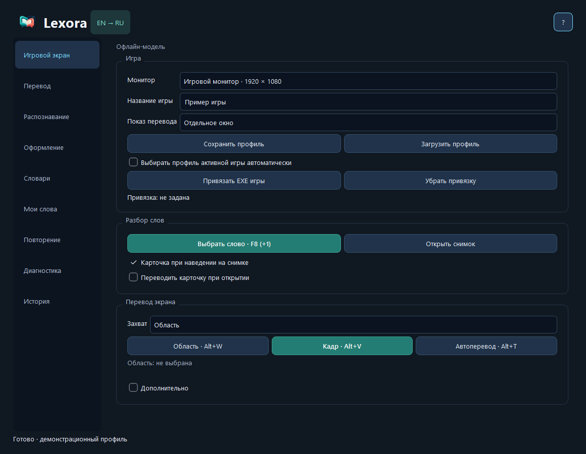

  
  <h1>Lexora</h1>
  
<strong>Играй на английском. Понимай на русском. Запоминай слова.</strong>

  
Экранный переводчик и словарь для Windows · EN → RU · Open source

  
  
  

Lexora распознаёт текст на экране игры, переводит реплики и помогает разбирать
незнакомые слова. Сохраняй значения вместе с контекстом и возвращайся к ним в повторении.
Программа бесплатная; выбранные внешние сервисы могут иметь свои тарифы и лимиты.

## Возможности

- Три действия: экранный словарь, перевод всего текущего кадра и автоперевод области или монитора.
- Экранный словарь: слова и фразы на полноэкранном снимке, карточка при наведении.
- Два режима: отдельное окно и внешний оверлей — перевод выше исходного текста или вместо него.
- Windows OCR и профили для белого, жёлтого и другого текста.
- Дополнительная локальная модель Lexora Game OCR для английских игровых текстов; выбор движка в настройках распознавания. Модель экспериментальная: состав обучения, замеры и ограничения описаны в [GAME_OCR.md](docs/GAME_OCR.md).
- FreeDict, WordNet и русский Викисловарь; пользовательские словари и коллекция слов.
- Повторение сохранённых слов, произношение английским голосом Windows.
- Отдельные привязки клавиатуры, мыши и геймпада: кнопки и сочетания, до четырёх вариантов на устройство.
- Размер интерфейса, карточки и прозрачность фона; профили игр и резервная копия.
- Защита игр: завершение Lexora или пауза без захвата и глобального ввода; список EXE настраивается.

## Скачать и запустить

Готовые опубликованные сборки находятся в [Releases](https://github.com/PepegaYoung/Lexora/releases/latest).
Актуальная portable-версия — **0.6.54**: [скачать для Windows](https://github.com/PepegaYoung/Lexora/releases/download/v0.6.54/Lexora-0.6.54-portable.zip).
Установщик для этой версии не выпускается.

1. Закрой предыдущую версию Lexora.
2. Распакуй **весь** portable-архив и открой `Lexora.exe`.
3. На вкладке «Перевод» выбери сервис и нажми «Использовать».
4. При необходимости выбери монитор в «Настройках». На «Игровом экране» нажми **Alt+Q**. Название игры и профиль необязательны.

Нужны Windows 10 (2004+)/11 x64 и английский компонент Windows OCR.
Python и права администратора для готовой сборки не требуются.
Офлайн-модель скачивается отдельно из приложения; в выпуске нет весов модели.
Приложение пока не подписано коммерческим сертификатом.

## Управление

| По умолчанию | Действие |
| --- | --- |
| Alt+Q | Экранный словарь: выбрать слово или фразу |
| Alt+W | Выбор области |
| Alt+V | Перевести текущий кадр: весь выбранный монитор один раз |
| Alt+T | Автоперевод / остановка |
| Escape | Закрыть активное окно экранного словаря; отменить запись клавиши |

В «Привязках» клавиатура, мышь и геймпад показаны вместе. Нажми поле нужного устройства.
Прожми **F8**, **Q**, **Alt+Z**, **Mouse4** или **Ctrl+Mouse5**. Правый клик по полю
позволяет добавить альтернативу, удалить сочетание или очистить привязки устройства. Они сохраняются сразу.
Для геймпада зажми нужные кнопки и отпусти: действие срабатывает при отпускании.
Поддерживаются PlayStation, Xbox и другие контроллеры, доступные Windows.Gaming.Input.
Список устройств обновляется кнопкой «Обновить геймпады».
Одиночные клавиши временно освобождаются в обычных окнах Lexora для ввода текста;
на снимке кадра они продолжают работать.

## Переводчики

| Подключение | Что нужно |
| --- | --- |
| Офлайн | Скачать локальную EN → RU модель; перевод на CPU |
| Яндекс (бесплатно) | Без ключа; неофициальное подключение, доступ может ограничиваться |
| MyMemory (бесплатно) | Доступ без ключа с квотой сервиса |
| Яндекс API / DeepL API | Собственный ключ и условия выбранного сервиса |
| OpenAI API | Собственный API-ключ; отдельная оплата |
| ChatGPT (подписка) | Экспериментальное OAuth-подключение; доступ зависит от аккаунта и допуска приложения |

Подписка ChatGPT и OpenAI API — разные подключения. Наличие Plus не гарантирует
доступ к OAuth или конкретным моделям. В выпуске нет чужих ключей или аккаунтов.

Для GPT список моделей загружается автоматически после подключения и обновляется
каждые пять минут на открытой вкладке «Перевод». Выбери модель и нажми «Использовать».
[Официальное описание каталога ChatGPT](https://developers.openai.com/siwc/token-sharing-open-source/models-and-inference).

## Данные и игры

OCR выполняется локально. При онлайн-переводе выбранному сервису отправляется
распознанный текст и контекст; изображение экрана не отправляется.
Слова и настройки хранятся на компьютере; ключи защищены Windows DPAPI.
Lexora не отправляет телеметрию или отчёты автоматически. [Подробнее о данных](docs/PRIVACY.md).

Режим отдельного окна выбран по умолчанию. Lexora не внедряется в игру и не читает
её память. Режим оверлея использует внешний оконный слой и обработчик Escape.
Боковые кнопки мыши используют отдельный локальный процесс; занятые сочетания — обработчик в процессе Lexora.
Совместимость и допуск конкретного античита **не гарантируются**; проверяй правила игры.
Проверки внутри защищённых игр не проводились.

## Документация и разработка

- [Руководство пользователя](docs/USER_GUIDE.md)
- [Сборка и тестирование](docs/DEVELOPMENT.md)
- [Изменения](CHANGELOG.md)
- [Как помочь проекту](CONTRIBUTING.md)
- [Безопасность](SECURITY.md)
- [Лицензии зависимостей и словарей](THIRD_PARTY.md)

Код приложения — **MIT**. Лицензии Qt, словарей, моделей и других зависимостей
сохраняются отдельно. Lexora — независимый проект, не связанный с издателями игр,
Wikimedia или перечисленными сервисами перевода.

## Защита игр

В «Настройки → Защита игр» можно выбрать игры, при запуске которых Lexora
закроется или отключит перевод и привязки. Эта функция не обходит античит.
Подробности и ограничения описаны в [руководстве пользователя](docs/USER_GUIDE.md).
